# Dependency graph of the Scala chain

Generated by `maintainers/scripts/dep-graph` from the derivations of `.#scala.latest`
(`nix derivation show -r`).  "A → B": B is built with A.  Only the steps of the chains are drawn,
and edges that follow from others are left out, so a JDK that every stage runs on shows up once,
at the first stage that needs it.  A box "X … Y (n stages)" is a run of steps that each build
only the next.  Every step is in `scala-dependency-graph.dot` (`dot -Tsvg scala-dependency-graph.dot`).
326 steps.

```mermaid
flowchart LR
  subgraph c0["Ant/ANTLR"]
    ant_bootstrap_1_8_4["ant-bootstrap-1.8.4"]
  end
  subgraph c1["JDK"]
    ecj_bootstrap_3_2_2["ecj-bootstrap-3.2.2 … openjdk-8u504-b01 (8 stages)"]
    jikes_1_22["jikes-1.22 … jamvm-1.5.1 (3 stages)"]
    openjdk_9_181["openjdk-9.181 … openjdk-21.0.12.1+1 (13 stages)"]
  end
  subgraph c2["PiCo"]
    jcup_bootstrapped_0_13["jcup-bootstrapped-0.13 … pico-2003 (3 stages)"]
  end
  subgraph c3["Scala 2"]
    scala_s195["s195 2017-10-05 … s206 2.13.0 (12 stages)"]
    scala_s207["s207 2018-03-01 … s208 2.12.8 (2 stages)"]
    scala_s209["s209 2.13.1"]
    scala_s210["s210 2020-02-04 … s212 2.13.2 (3 stages)"]
    scala_s213["s213 2.13.3"]
    scala_s214["s214 2020-11-03 … s217 2.13.4 (3 stages)"]
    scala_s218["s218 2.13.5"]
    scala_s219["s219 2.13.6"]
    scala_s220["s220 2.13.8"]
    scala_s221["s221 2022-05-12 … s224 2.13.10 (3 stages)"]
    scala_s225["s225 2023-08-16 … s226 2.13.12 (2 stages)"]
    scala_s227["s227 2.13.14"]
    scala_s228["s228 2.13.15"]
    scala_s229["s229 2.13.16"]
    scala_s230["s230 2.13.18"]
    scala_st1["st1 2004-02-19 … s194 2.12.0 (189 stages)"]
  end
  subgraph c4["Scala 3"]
    scala_d0["d0 0.14.0-RC1 … d5 0.17.0-RC1 (6 stages)"]
    scala_d10["d10 0.19.0-RC1 … d22 0.24.0 nightly 20200407 (13 stages)"]
    scala_d23["d23 0.24.0-RC1 … d24 0.25.0-RC2 (2 stages)"]
    scala_d25["d25 0.26.0 nightly 20200707 … d32 3.0.0-M2 nightly 20201112 (8 stages)"]
    scala_d33["d33 3.0.0-M2 … d38 3.0.0-RC1 (6 stages)"]
    scala_d39["d39 3.0.0-RC2 nightly 20210318 … d41 3.0.0 (3 stages)"]
    scala_d42["d42 3.1.0-RC1 nightly 20210823 … d47 3.1.1 (6 stages)"]
    scala_d48["d48 3.1.2 … d50 3.2.0 (3 stages)"]
    scala_d51["d51 3.2.1 … d54 3.3.1 (4 stages)"]
    scala_d55["d55 3.4.0 … d57 3.4.2 (3 stages)"]
    scala_d58["d58 3.5.0 … d60 3.5.2 (3 stages)"]
    scala_d6["d6 0.18.1 nightly 20190823 … d9 0.19.0 nightly 20190917 (4 stages)"]
    scala_d61["d61 3.6.2 … d63 3.6.4 (3 stages)"]
    scala_d64["d64 3.7.0 … d68 3.7.4 (5 stages)"]
    scala_d69["d69 3.8.1 … d74 3.10.0 (6 stages)"]
  end
  ant_bootstrap_1_8_4 --> ecj_bootstrap_3_2_2
  ecj_bootstrap_3_2_2 --> jcup_bootstrapped_0_13
  ecj_bootstrap_3_2_2 --> openjdk_9_181
  jcup_bootstrapped_0_13 --> scala_st1
  jikes_1_22 --> ant_bootstrap_1_8_4
  openjdk_9_181 --> scala_st1
  scala_d0 --> scala_d6
  scala_d10 --> scala_d23
  scala_d23 --> scala_d25
  scala_d25 --> scala_d33
  scala_d33 --> scala_d39
  scala_d39 --> scala_d42
  scala_d42 --> scala_d48
  scala_d48 --> scala_d51
  scala_d51 --> scala_d55
  scala_d55 --> scala_d58
  scala_d58 --> scala_d61
  scala_d6 --> scala_d10
  scala_d61 --> scala_d64
  scala_d64 --> scala_d69
  scala_s195 --> scala_d6
  scala_s195 --> scala_s209
  scala_s207 --> scala_d0
  scala_s209 --> scala_d10
  scala_s209 --> scala_s210
  scala_s210 --> scala_d23
  scala_s210 --> scala_s213
  scala_s213 --> scala_d25
  scala_s213 --> scala_s214
  scala_s214 --> scala_d33
  scala_s214 --> scala_s218
  scala_s218 --> scala_d39
  scala_s218 --> scala_s219
  scala_s219 --> scala_d42
  scala_s219 --> scala_s220
  scala_s220 --> scala_d48
  scala_s220 --> scala_s221
  scala_s221 --> scala_d51
  scala_s221 --> scala_s225
  scala_s225 --> scala_d55
  scala_s225 --> scala_s227
  scala_s227 --> scala_d58
  scala_s227 --> scala_s228
  scala_s228 --> scala_d61
  scala_s228 --> scala_s229
  scala_s229 --> scala_d64
  scala_s229 --> scala_s230
  scala_s230 --> scala_d69
  scala_st1 --> scala_s195
  scala_st1 --> scala_s207
```

